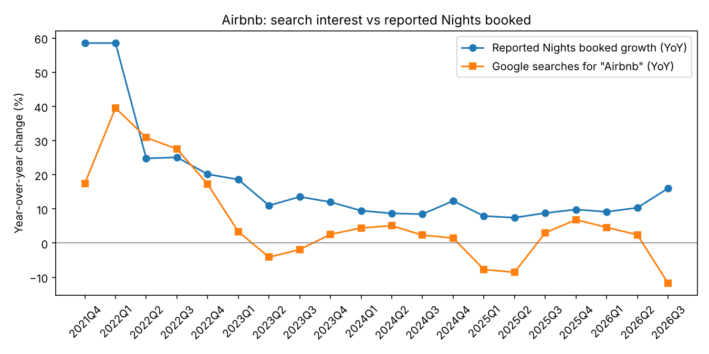
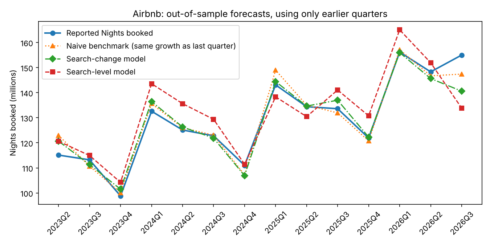

# Airbnb (ABNB): Google searches vs nights booked

KPI: nights and experiences booked (renamed "nights and seats booked" in 2025), 24 quarters (Q4 2020 to Q3 2026), scraped from Airbnb's SEC earnings filings by `src/scrape_kpi.py`. Every row in [`kpi.csv`](kpi.csv) links to its filing and the exact text matched.

## Results

**Short answer: no. After the Q3 2026 miss, search does worse than the benchmark on average, and it was closer in fewer than half the quarters.**

| | Result |
|---|---|
| Quarters compared (YoY growth) | 20 (Q4 2021 to Q3 2026) |
| Correlation, search growth vs booking growth | 0.73 |
| Out-of-sample quarters tested | 14 |
| Error, naive benchmark (same growth as last quarter) | 2.80M nights |
| Error, search-change model | 3.07M nights (9% worse) |
| Error, search-level model | 7.14M nights (155% worse) |
| Search-change model calling acceleration vs deceleration | 8 of 14 quarters (57%) |
| Search-change model closer than the benchmark | 6 of 14 quarters |
| Search-change model without its single best quarter | 25% worse than the benchmark |

**What happened:** booking growth stayed between roughly 7% and 14% a year from mid-2023 to mid-2026, then jumped to 16.0% in Q3 2026. Before that quarter, the search-change model was 10% better than the benchmark, mainly thanks to two quarters where the benchmark carried forward an unusual number. In Q2 2023 it assumed the 18.6% growth of Q1 would continue (actual: 11.0%), and in Q1 2025 it carried forward Q4 2024's 12.3% (actual: 7.9%, partly a calendar effect, since Q1 2024 had the extra Leap Day). Search pointed lower both times. Q3 2026 undid that edge. Search growth fell from +2.4% in Q2 to -11.7%, so the model cut its forecast to 5.2% growth, while the benchmark said 10.3% and the actual was 16.0%. That one quarter, the model's worst of the test, turned a 10% edge into 9% worse. The search-level model failed throughout.

**Why it doesn't work here:** the idea still makes sense. A trip usually starts with a search, so search interest should be close to the moment of demand. In practice, Airbnb's growth was too steady for search to add much, it mostly helped when last quarter's growth was a poor guide for calendar reasons, and in Q3 2026 it pointed the wrong way by a wide margin. One possible reason is covered under the Q3 2026 result below.

**How much to trust it:** the negative result is more solid than the earlier positive one was, but it is still based on 14 tested quarters, so treat it as directional. Without its single best quarter (Q1 2025), search does 25% worse than the benchmark. The verdict also changed from "only on average" to "no" after one new quarter, which shows how little the earlier edge rested on. The 0.73 correlation is flattered by the post-pandemic rebound in 2021 and 2022, when both series swung far more than they do today.

## Prediction for Q4 2026

Not made yet. A full quarter of search data (October to December) is needed first, so this will be recorded in early January 2027, before Airbnb reports Q4 2026.

## Prediction for Q3 2026

Made before Airbnb reports Q3 2026. The 2 October call is kept as recorded; the 16 October row is a re-run after switching to scraped KPI data and full-history monthly search data.

| Made on | Naive benchmark | Search-change model | Search-level model (not trusted given its record) | Search interest YoY |
|---|---|---|---|---|
| 2 October 2026 | 147.4M (10.3%) | 142.0M (6.3%) | 140.1M (4.9%) | -12.6% |
| 16 October 2026 | 147.4M (10.3%) | 140.6M (5.2%) | 133.8M (0.2%) | -11.7% |
| Reported | **155.0M (16.0%)**, [SEC filing](https://www.sec.gov/Archives/edgar/data/0001559720/000119312526449727/d437988dex991.htm) | | | |

My original call was about **142M**, a slowdown to roughly 6% growth, and the re-run points the same way (140.6M). Given how weak the evidence above is, a result close to the benchmark's 147M would not be surprising, and that would count against the search signal.

One risk to this call: Google search volumes overall may be shifting as more people get answers from AI assistants and AI search summaries. A broad decline in searching would show up as weaker search interest without any real drop in travel demand.

**Result:** the call missed. Nights and seats booked came in at 155.0M, up 16% YoY, and the naive benchmark was the closest forecast.

| Forecast | Predicted | Actual | Miss |
|---|---|---|---|
| Naive benchmark (same on both dates) | 147.4M (10.3%) | 155.0M (16.0%) | 7.6M too low (4.9%) |
| Search-change model, 2 October (original call) | 142.0M (6.3%) | 155.0M (16.0%) | 13.0M too low (8.4%) |
| Search-change model, 16 October | 140.6M (5.2%) | 155.0M (16.0%) | 14.4M too low (9.3%) |
| Search-level model, 2 October / 16 October | 140.1M / 133.8M | 155.0M (16.0%) | 14.9M / 21.2M too low |

The search signal pointed to a slowdown and bookings accelerated instead. By the test set out above, this counts against the search signal: the result was not just close to the benchmark, it was above it.

**A possible reason:** search interest for "Airbnb" was down about 12% YoY in Q3 2026 while bookings grew 16%, the fastest growth since Q1 2023. That gap fits the risk flagged above: if more trip planning now starts in AI assistants instead of Google, search interest can fall without demand falling. This is a possible explanation, not a proven one. It is one quarter, and nothing here measures how much travel planning has actually moved to AI tools.

## Next steps

- **Region-level search:** worldwide search mixes Airbnb's mature North American market with fast-growing regions. Searching by country could separate the two.
- **Travel-specific terms:** searches like "Airbnb Paris" or "vacation rental" may track booking intent more closely than the brand name alone.
- **Check for a broad fall in searching:** compare the Airbnb trend with a control term that has steady real-world demand. If the control fell by a similar amount in 2026, that supports the AI explanation above.
- **Wait for more quarters:** each new quarter adds one more test, and the scraper now collects it automatically.
