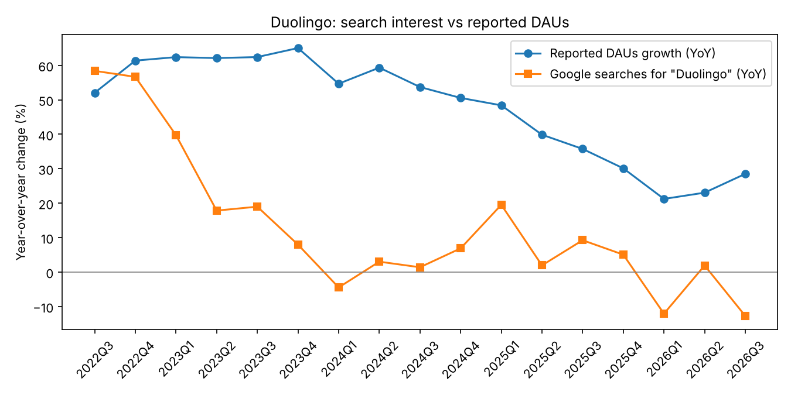
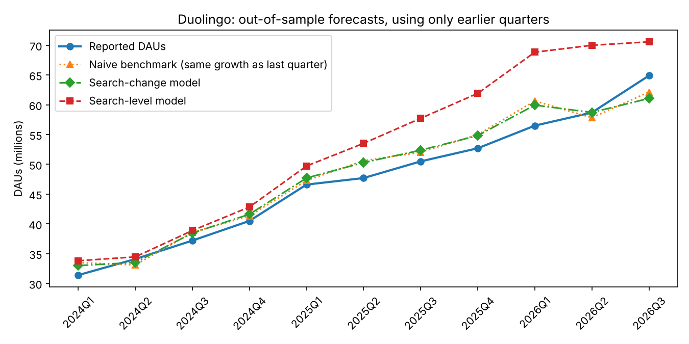

# Duolingo (DUOL): Google searches vs daily active users

KPI: daily active users (DAUs), 21 quarters (Q3 2021 to Q3 2026), scraped from Duolingo's SEC earnings filings by `src/scrape_kpi.py`. Every row in [`kpi.csv`](kpi.csv) links to its filing and the exact text matched.

I hold Duolingo in my own portfolio, so this was also a way to check the user growth story with data instead of waiting for the shareholder letter.

## Results

**Short answer: yes, but only slightly, and only just. Search nudged forecasts in the right direction in most quarters, by small amounts, but the Q3 2026 miss cut its edge from 11% to 4%, and without its best quarter it is about even with the benchmark.**

| | Result |
|---|---|
| Quarters compared (YoY growth) | 17 (Q3 2022 to Q3 2026) |
| Correlation, search growth vs DAU growth | 0.53 |
| Out-of-sample quarters tested | 11 |
| Error, naive benchmark (same growth as last quarter) | 1.86M DAUs |
| Error, search-change model | 1.78M DAUs (4% better) |
| Error, search-level model | 5.59M DAUs (200% worse) |
| Search-change model calling acceleration vs deceleration | 7 of 11 quarters (64%) |
| Search-change model closer than the benchmark | 7 of 11 quarters |
| Search-change model without its single best quarter | 0% better than the benchmark (about even) |

**What happened:** DAU growth slowed steadily from around 55% a year in early 2024 to 21% in Q1 2026, then picked up again: 23% in Q2 and 28.5% in Q3 2026. During the slowdown, search growth slowed too, and the search-change model used that to shade its forecasts a little below the benchmark. That worked in 7 of the first 10 quarters, by small amounts. In Q3 2026 search growth fell from +1.9% in Q2 to -12.7%, so the model cut its forecast to 20.9% growth, while the benchmark said 23.1% and the actual was 28.5%. That was the model's worst quarter of the test, and it took the average edge from 11% to 4%. The improvement is now about 0.1M DAUs per quarter on a base of roughly 55M. The search-level model failed throughout, because it learned the relationship from the early high-growth years and kept predicting growth that never came back.

**Why it works here, a little:** search interest mostly reflects people discovering Duolingo, not existing users opening the app. So it can't explain how users roughly tripled from Q2 2023 (21.4M) to Q3 2026 (64.9M) while search interest grew far less. That growth looks driven by retention and engagement (streaks, notifications, gamification). What search can do is pick up a slowdown in new-user interest, and that seems to be the part of DAU growth it helped forecast. Q3 2026 fits this story from the other side: DAUs accelerated while searches fell, which suggests the growth came from somewhere search doesn't see. Both points are hypotheses the data can't prove on its own.

**How much to trust it:** cautiously, and less than before. An earlier version of this analysis (hand-entered KPIs with a two-quarter gap, and 5 years of weekly search data) found search did 4% worse than the benchmark over 7 quarters. Filling the gap and using the full search history flipped that to 11% better over 10 quarters, and one more quarter cut it to 4% better over 11. The verdict still reads "consistently" because it wins in 7 of 11 quarters and stays marginally ahead without its best quarter (Q2 2026), but that margin is too small to mean much. 11 tested quarters is a small sample, so treat this as directional.

## Prediction for Q4 2026

Not made yet. A full quarter of search data (October to December) is needed first, so this will be recorded in early January 2027, before Duolingo reports Q4 2026.

## Prediction for Q3 2026

Made before Duolingo reports Q3 2026. The 2 October call is kept as recorded; later rows are re-runs after data changes (14 October: scraped KPI data; 16 October: full-history monthly search data).

| Made on | Naive benchmark | Search-change model | Search-level model (not trusted given its record) | Search interest YoY |
|---|---|---|---|---|
| 2 October 2026 | 62.1M (23.1%) | 62.0M (22.9%) | 69.4M (37.4%) | -12.8% |
| 14 October 2026 | 62.1M (23.1%) | 61.7M (22.2%) | 69.3M (37.2%) | -12.8% |
| 16 October 2026 | 62.1M (23.1%) | 61.1M (20.9%) | 70.6M (39.7%) | -12.7% |
| Reported | **64.9M (28.5%)**, [SEC filing](https://www.sec.gov/Archives/edgar/data/0001562088/000162828026069474/q3fy26duolingo9-30x26share.htm) | | | |

My original call was about **62M**, and the current search-change model says **61.1M**. Both sit close to the benchmark, so the real test is whether the small downward nudge from search lands closer than simply carrying Q2's growth forward.

**Result:** the call missed. DAUs came in at 64.9M, up 29% YoY (28.5% unrounded), and the naive benchmark was the closest forecast. The downward nudge from search went the wrong way.

| Forecast | Predicted | Actual | Miss |
|---|---|---|---|
| Naive benchmark (same on all dates) | 62.1M (23.1%) | 64.9M (28.5%) | 2.8M too low (4.3%) |
| Search-change model, 2 October (original call) | 62.0M (22.9%) | 64.9M (28.5%) | 2.9M too low (4.5%) |
| Search-change model, 14 October | 61.7M (22.2%) | 64.9M (28.5%) | 3.2M too low (4.9%) |
| Search-change model, 16 October | 61.1M (20.9%) | 64.9M (28.5%) | 3.8M too low (5.9%) |
| Search-level model, 2 / 14 / 16 October | 69.4M / 69.3M / 70.6M | 64.9M (28.5%) | 4.5M / 4.4M / 5.7M too high |

At the original call the benchmark was closer by only 0.1M, but each re-run moved the search-change model further from the actual number.

**A possible reason:** search interest for "Duolingo" was down about 12% YoY in Q3 2026 while DAU growth accelerated. The Airbnb README flags a broader risk that fits this: if more people get answers from AI assistants instead of Google, search interest can fall without any drop in real usage. For Duolingo there is also the retention point above, since growth from existing users never shows up in searches. Both are possible explanations, not proven ones, and this is a single quarter.

## Next steps

- **Signals closer to the product:** app store rankings or download estimates, and Wikipedia page views, may track usage better than search.
- **Country-level search:** worldwide search mixes mature and fast-growing markets. Checking, say, the US against India could show where search still works.
- **Explain retention directly:** compare DAU/MAU (the share of monthly users who show up daily) with search, to test the retention story above.
